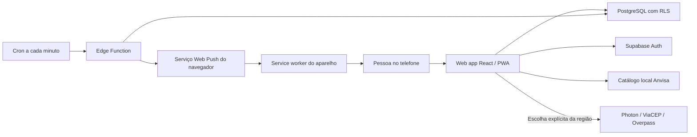

# MEDControl — base para o TCC

## Problema e proposta

Pessoas em tratamentos contínuos precisam conciliar horários, nomes, quantidades e reposições. Quem tem pouca experiência digital enfrenta barreiras adicionais para configurar e consultar aplicativos. O MEDControl propõe um web app acessível pelo telefone para organizar essa rotina, com permissões compreensíveis e informações de apoio à reposição.

A implementação é um **protótipo funcional acadêmico**. Não há evidência de eficácia clínica, certificação de dispositivo médico ou avaliação formal de conformidade à LGPD nesta entrega. Essas afirmações exigiriam estudos e processos próprios.

## Objetivo geral

Desenvolver e avaliar uma aplicação web para organizar medicamentos prescritos, registrar a confirmação de doses e apoiar o planejamento de reposições, com atenção à autonomia e à usabilidade de pessoas com pouca familiaridade com smartphones.

## Objetivos específicos

1. Implementar autenticação e isolamento de dados por usuário.
2. Organizar medicamentos e horários em uma agenda diária.
3. Solicitar consentimento para notificações e localização a partir de ações explícitas.
4. Evitar registros duplicados e atualizar estoque de forma consistente.
5. Permitir identificar nomes de medicamentos em dados públicos oficiais sem recomendar posologia.
6. Localizar farmácias por proximidade ou busca manual, com limitações claras.
7. Avaliar a compreensão das ações e a conclusão de tarefas no telefone.

## Requisitos implementados

| Código | Requisito | Evidência |
|---|---|---|
| RF01 | Cadastro, entrada e recuperação | Supabase Auth; login real testado |
| RF02 | Cadastrar/editar medicamento | Formulário de três etapas e resumo |
| RF03 | Agenda e confirmação | Horários e estado de cada dose |
| RF04 | Evitar duplicação | Transação com bloqueio de linha e índice único |
| RF05 | Estoque e reposição | Consumo por tomada, soma de reposição, precisão decimal |
| RF06 | Histórico | Registros preservados ao arquivar, filtros e CSV |
| RF07 | Lembretes | Permissão por gesto, Web Push, worker e dispatcher |
| RF08 | Identificação por nome | Snapshot oficial da Anvisa pesquisado localmente |
| RF09 | Farmácias próximas | Overpass, geolocalização opcional, Photon e ViaCEP |
| RF10 | Ajuda e legibilidade | “Como usar”, texto ampliado, navegação móvel |

## Arquitetura

No banco, `medications` contém a rotina atual; `dose_records` preserva o nome, a dose, o horário previsto e o instante da confirmação. `push_subscriptions` relaciona o aparelho ao usuário; `notification_deliveries` evita repetição de entregas; a configuração privada do dispatcher não é exposta ao cliente.

A confirmação de uma dose bloqueia o medicamento na transação, valida a conta, horário e estoque, grava o registro e desconta o consumo. Um índice único impede duas confirmações para a mesma conta, medicamento, dia e horário, inclusive em aparelhos diferentes.

A consulta de medicamentos não informa a uma API quais nomes a pessoa pesquisou: uma cópia pública é carregada e filtrada no aparelho. A consulta de mapas não envia a lista de medicamentos nem o identificador da conta. A localização aproximada permanece na memória da página e é descartada ao remover a localização ou sair.

## Roteiro de demonstração

1. Abrir a tela inicial de acesso e explicar a identidade “Cada cuidado conta”.
2. Entrar na demonstração e mostrar que os dados são fictícios.
3. Abrir “Como usar” e seguir o cadastro em etapas.
4. Buscar um nome na Anvisa, conferir a origem e observar que a dose continua em branco.
5. Informar dados fictícios, horários e estoque, revisar e salvar.
6. Confirmar uma dose cujo horário já chegou; conferir histórico e desconto do estoque.
7. Repor uma quantidade e mostrar que ela é somada ao saldo.
8. Abrir farmácias a partir do alerta; buscar uma cidade pública de referência e ordenar pela distância.
9. Mostrar que localização e notificações são escolhas, com alternativa manual e instruções de bloqueio.
10. Arquivar o medicamento e demonstrar a permanência do histórico.

O ambiente real deve usar contas de avaliação autorizadas. Não exibir dados de saúde de participantes em apresentações públicas. Testes automatizados de banco usam apenas contas descartáveis, sem envio de e-mail.

## Proposta de avaliação de usabilidade

Recrutar voluntários adultos com diferentes níveis de experiência digital, incluindo pessoas idosas, mediante consentimento e aprovação institucional quando aplicável. Utilizar medicamentos fictícios e dados mínimos.

Tarefas: criar cadastro de medicamento, localizar a próxima dose, confirmar uma tomada, repor estoque, encontrar farmácia por cidade e localizar a configuração de notificações. Medir conclusão sem ajuda, tempo, erros, necessidade de intervenção e compreensão dos avisos. Complementar com entrevista breve e instrumento de usabilidade adequado ao protocolo de pesquisa.

Essas sessões ainda precisam ser realizadas. Os testes de software não demonstram, por si, compreensão pelo público final nem melhoria de adesão clínica.

## Limites e evolução

- O sistema registra declarações do usuário, sem comprovar ingestão ou realizar recomendação clínica.
- A rotina atual é diária; não representa, nesta versão, tratamentos em dias alternados, datas finais ou uso “se necessário”.
- O acompanhamento usa os horários atuais desde o cadastro; alterações não são versionadas como prescrição histórica.
- Não há integração com estoque, preço, dispensação do SUS ou Farmácia Popular. Os estabelecimentos precisam confirmar disponibilidade.
- Entrega de push depende de permissão, conectividade, navegador e políticas de bateria. Não é um alarme médico garantido.
- Produção exige domínio HTTPS, configuração de e-mail, revisão operacional, backups, responsável pelos dados e processo de exclusão de conta.
- A consulta do histórico exibe os 5.000 registros mais recentes; a exportação usa os registros carregados. O banco preserva os demais registros.
- O catálogo é um snapshot e precisa de atualização periódica. Os mapas são colaborativos e podem estar incompletos.

## Referências técnicas

- [Supabase Auth](https://supabase.com/docs/guides/auth/passwords)
- [Row Level Security](https://supabase.com/docs/guides/database/postgres/row-level-security)
- [Notificações e Push API](https://developer.mozilla.org/en-US/docs/Web/API/Push_API)
- [Dados abertos oficiais da Anvisa](https://www.gov.br/anvisa/pt-br/assuntos/fiscalizacao-e-monitoramento/farmacovigilancia/relatorios-periodicos-de-avaliacao-beneficio-risco-rpbr-1)
- [Atribuição OpenStreetMap](https://www.openstreetmap.org/copyright)
- [WCAG 2.2](https://www.w3.org/TR/WCAG22/)

## Revisão ECC e integração Google Maps — 23/11/2026

A busca de farmácias cruza a região escolhida com os dados públicos de estabelecimentos do OpenStreetMap, usando Photon e ViaCEP para localizar cidade/bairro/CEP. Não exige chave de mapas nem faturamento. A pessoa também pode abrir Google Maps por links públicos de busca e trajeto, sem SDK Google. As rotas públicas `/privacidade` e `/termos` descrevem os serviços envolvidos. Antes da disponibilização pública, a equipe deve definir o canal de suporte/exclusão e revisar as informações de operação.

A revisão corrigiu saída visível no telefone, perda do formulário ao atualizar em segundo plano, navegação de recuperação de senha, persistência da demonstração vazia e conflito de estoque entre aparelhos. O histórico passou a usar paginação por cursor, com teto de 5.000 registros carregados. A fila de push usa tentativas com token e expiração, distinguindo aceitação pelo provedor de recebimento observado no telefone. Consulte `structure-review.md` e `verification.md` para evidências e limites.
